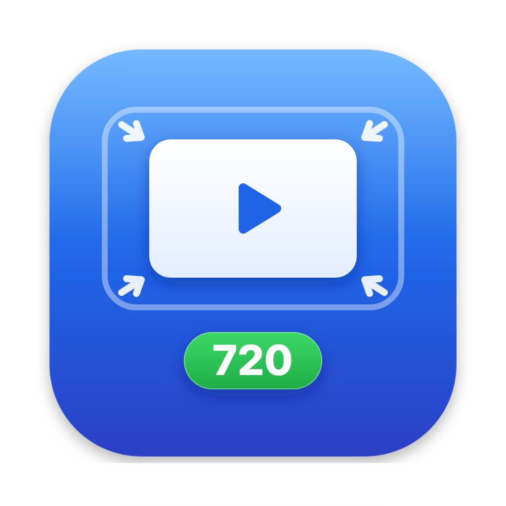
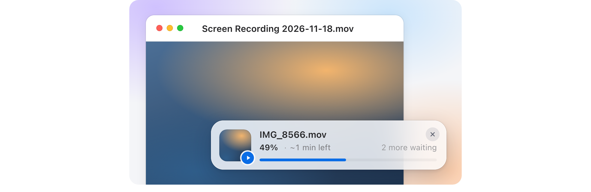
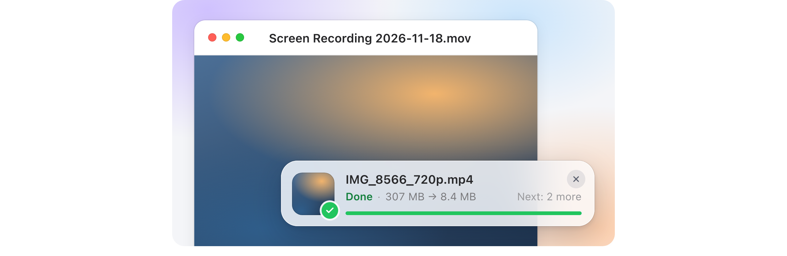

# Screenshot 720p Converter

A small macOS background app that watches `~/Documents/Screenshot` and, whenever a
video lands there, saves a compressed **720p H.264 copy** into `Screenshot/720p/`.
Originals are never touched.

<p>
  
  
</p>
<sub>Design mockup at 1.5× over a desktop corner.</sub>

## Features

- **Automatic:** reacts to new files in the folder (no polling); waits until a
  recording or copy has finished writing before converting.
- **Floating progress panel:** frosted glass, bottom-right of the screen the mouse is on —
  video thumbnail, percent, time left, how many videos are waiting, and an **X** to close it.
  Appears only for jobs longer than ~1.5 s, shows *Done* for 3 s, then fades. Never steals
  focus, floats over full-screen apps, and is hidden from screenshots/screen recordings.
- **Notifications:** *Converting…*, *720p copy ready — 307 MB → 8.4 MB* (click to reveal in
  Finder), and *Couldn't convert* (only on the first failure, not on every retry).
- **Safe output:** fits within 1280×720 keeping aspect ratio, H.264 CRF 24 + AAC 128k,
  `+faststart`; HDR is tone-mapped to SDR. Each copy is checked (resolution, duration, audio)
  before it appears, and existing files are never overwritten.
- **iPhone videos:** extra audio tracks ffmpeg can't decode (e.g. Apple spatial audio, `apac`)
  are skipped; the normal stereo track is kept.
- **No duplicates:** a record of every converted file (by inode, size and modification time)
  means each video is converted once. Failed files are retried every 5 minutes.

## Requirements

- macOS 13 or later (Apple silicon)
- [Homebrew](https://brew.sh) ffmpeg at `/opt/homebrew/bin/ffmpeg` — `brew install ffmpeg`
- Python 3.13 from [python.org](https://www.python.org/downloads/macos/) at
  `/Library/Frameworks/Python.framework/Versions/3.13/bin/python3`
- Xcode Command Line Tools (for `swiftc`) — `xcode-select --install`

## Install / update

```bash
./install.sh
```

This runs the tests, builds and ad-hoc signs the app, backs up the installed copy to
`~/Library/Application Support/Screenshot720p/backup/`, waits for any conversion in progress,
installs to `/Applications/Screenshot 720p Converter.app`, and (re)starts the launch agent
`local.yen.screenshot720p`, which keeps it running and starts it at login.

`./install.sh --build-only` builds into `build/` without touching the installed app.

On first run macOS asks for access to **Documents** and permission to send **notifications**;
both can be changed later in System Settings (Privacy & Security → Files & Folders, and
Notifications).

## How it works

```
FSEvents ─▶ ConverterLauncher (Swift, AppKit)
                 │  runs one worker at a time, reads its stdout
                 ▼
            screenshot_720p.py ─▶ ffprobe / ffmpeg ─▶ Screenshot/720p/<name>_720p.mp4
                 │  JSON events: start · progress · done · failed
                 ▼
            ProgressPanel (floating window) + Notifier (UserNotifications)
```

| Path | What it is |
|---|---|
| `src/main.swift` | Launcher: folder watcher, worker scheduling, event handling |
| `src/ProgressPanel.swift` | The floating progress window |
| `src/Notifier.swift` | Notifications |
| `src/screenshot_720p.py` | Worker: scan, convert, verify, emit progress |
| `support/` | App `Info.plist`, `AppIcon.icns` and the launch agent plist |
| `assets/icon/` | Icon source (`icon.svg`), `render.mjs` → PNG, `make-icns.sh` → `AppIcon.icns` |
| `tests/test_events.py` | End-to-end tests of the worker's events |
| `docs/` | Design spec, plan and mockups |

State and logs live in `~/Library/Application Support/Screenshot720p/`
(`state.json`, `converter.log`).

## Tests

```bash
/Library/Frameworks/Python.framework/Versions/3.13/bin/python3 -m unittest discover -s tests -v
```

## Known limits

- Renaming a video, or editing the original, makes a second 720p copy (the old one is kept,
  the new one gets a suffix).
- Deleting a 720p copy makes the app convert that video again.
- The watched folder is `~/Documents/Screenshot`; to use another, add `--folder` and the
  path to `ProgramArguments` in `support/local.yen.screenshot720p.plist` and reinstall.

## Uninstall

```bash
launchctl bootout gui/$(id -u)/local.yen.screenshot720p
rm ~/Library/LaunchAgents/local.yen.screenshot720p.plist
rm -rf "/Applications/Screenshot 720p Converter.app" ~/Library/Application\ Support/Screenshot720p
```
